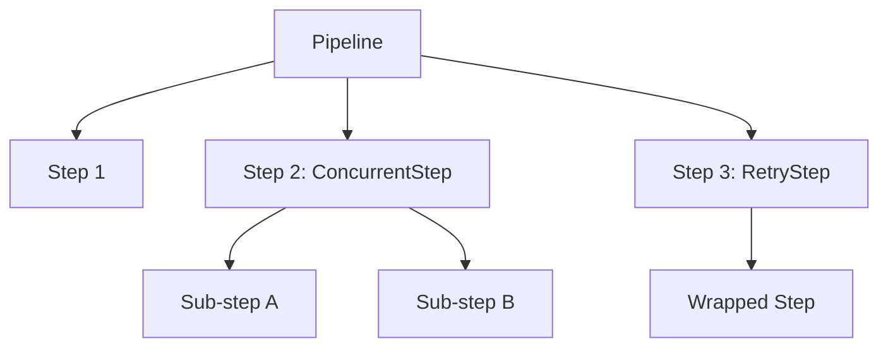

# pipelines

A Go library for building and running structured, observable pipelines made up of discrete steps. Steps can be shell commands, Go functions, or concurrent groups — all wired together with structured logging, spinner output, retry logic, and graceful cancellation.

## Features

- **Sequential pipelines** — ordered list of steps that stop on first failure
- **Concurrent steps** — run multiple steps in parallel inside a single pipeline slot, with optional concurrency cap
- **Concurrent pipelines** — run multiple whole pipelines at the same time
- **Retry** — wrap any step with configurable attempts, backoff, jitter, and per-error hooks
- **Structured logging** — all status output goes through a `logrus.Logger` (injected via context or auto-created per writer)
- **Spinner** — animated terminal progress shared across nested concurrent steps
- **Filesystem lock** — reentrant, context-aware file lock for coordinating landscape-scoped operations
- **Log files** — each pipeline writes a persistent log file under its `LogDir`

## Installation

```sh
go get github.com/hyeondg/pipelines
```

## Concepts



| Type | Description |
|---|---|
| `Pipeline` | Ordered container of `Step` values |
| `Command` | Wraps an external binary (`exec.Command`) |
| `FuncStep` | Wraps an arbitrary `func(ctx, w) error` |
| `ConcurrentStep` | Runs a slice of steps in parallel |
| `RetryStep` | Wraps any step with retry/backoff logic |

## Quick start

```go
package main

import (
    "context"
    "os"
    "os/signal"
    "syscall"

    "github.com/hyeondg/pipelines"
)

func main() {
    ctx, stop := signal.NotifyContext(context.Background(), syscall.SIGINT, syscall.SIGTERM)
    defer stop()

    p := pipelines.Pipeline{
        Name:        "hello",
        Description: "A minimal example",
        LogDir:      os.TempDir(),
    }

    p.AddCommand(pipelines.Command{
        Name:        "greet",
        Description: "print a greeting",
        Executable:  "echo",
        Args:        []string{"hello, world"},
    })

    if err := p.Run(ctx); err != nil {
        panic(err)
    }
}
```

## Step types

### Command

Runs an external binary. Stdout and stderr are both forwarded to the pipeline writer.

```go
p.AddCommand(pipelines.Command{
    Name:        "build",
    Description: "compile all packages",
    Executable:  "go",
    Args:        []string{"build", "./..."},
})
```

Flags and options can be attached separately:

```go
cmd := pipelines.Command{
    Name:       "lint",
    Executable: "golangci-lint",
    Args:       []string{"run"},
}
cmd.AddOption(pipelines.Option{
    Long:        "--timeout",
    HasValue:    true,
    Value:       "5m",
    Description: "per-linter timeout",
})
p.AddCommand(cmd)
```

### FuncStep

Wrap any Go function as a step:

```go
p.AddFunc("validate", "check config", func(ctx context.Context, w io.Writer) error {
    cfg, err := loadConfig()
    if err != nil {
        return err
    }
    return cfg.Validate()
})
```

Or register a pre-built `FuncStep`:

```go
p.AddFuncStep(pipelines.FuncStep{
    Name:        "notify",
    Description: "send Slack message",
    Fn:          sendSlackNotification,
})
```

### ConcurrentStep

Run steps in parallel within a single pipeline slot. All sub-steps must complete before the pipeline advances. The first failure cancels the rest.

```go
p.AddStep(&pipelines.ConcurrentStep{
    Name:        "parallel-checks",
    Description: "vet and test simultaneously",
    Steps: []pipelines.Step{
        &pipelines.Command{Name: "vet",  Executable: "go", Args: []string{"vet",  "./..."}},
        &pipelines.Command{Name: "test", Executable: "go", Args: []string{"test", "./..."}},
    },
})
```

Set `MaxConcurrency` to limit simultaneous goroutines (useful with large step slices):

```go
&pipelines.ConcurrentStep{
    MaxConcurrency: 4,
    Steps:          manySteps,
}
```

### RetryStep

Wrap any `Step` with automatic retry on failure:

```go
import "github.com/codeGROOVE-dev/retry"

p.AddStep(pipelines.WithRetry(myStep, pipelines.RetryConfig{
    Attempts:  5,
    Delay:     2 * time.Second,
    MaxDelay:  30 * time.Second,
    DelayType: retry.BackOffDelay, // exponential; also: FixedDelay, FullJitterBackoffDelay
}))
```

Every failed attempt is automatically logged. Supply `OnRetry` for additional side-effects:

```go
pipelines.RetryConfig{
    Attempts: 3,
    Delay:    1 * time.Second,
    RetryIf: func(err error) bool {
        return isTransient(err) // skip retry for permanent failures
    },
    OnRetry: func(attempt uint, err error) {
        metrics.Inc("step.retry")
    },
}
```

Mark an error unrecoverable to stop retrying immediately:

```go
return retry.Unrecoverable(err)
```

## Running pipelines

### Sequential

```go
// Run writes to os.Stdout.
if err := p.Run(ctx); err != nil { ... }

// RunWithWriter sends all output to a custom writer.
if err := p.RunWithWriter(ctx, myWriter); err != nil { ... }
```

### Concurrent

```go
all := []pipelines.Pipeline{buildPipeline, testPipeline, lintPipeline}

// Stop all on first failure (default).
err := pipelines.RunPipelinesConcurrently(ctx, all)

// Keep remaining pipelines running after a failure; collect all errors.
err = pipelines.RunPipelinesConcurrently(ctx, all, pipelines.ContinueOnError())
```

## Structured logging

Every status message (step started, completed, failed, retried) is routed through a `logrus.Logger`. Inject one via context to use your application's logger:

```go
log := logrus.New()
log.SetFormatter(&logrus.JSONFormatter{})
ctx = pipelines.ContextWithLogger(ctx, log)

p.Run(ctx) // all messages use the injected logger
```

Without an injected logger, a default one is created automatically and writes to the pipeline writer.

Retrieve the logger from inside a `FuncStep`:

```go
p.AddFunc("work", "do something", func(ctx context.Context, w io.Writer) error {
    log := pipelines.LoggerFromContext(ctx) // may be nil if not injected
    if log != nil {
        log.Info("inside step")
    }
    return doWork()
})
```

## Log files

Each pipeline writes a `.log` file to its `LogDir`:

```go
p := pipelines.Pipeline{
    Name:   "deploy",
    LogDir: "/var/log/myapp",
}
// Writes to /var/log/myapp/deploy.log

fmt.Println(p.GetLogFilePath()) // "/var/log/myapp/deploy.log"
```

When `LogDir` is empty, the pipeline resolves it in this order:

1. `$landscape` context value → `<landscape>/hdlogs/<name>/`
2. A temporary directory created with `os.MkdirTemp`

## Filesystem lock

`AcquireConfigLock` / `ReleaseConfigLock` provide a reentrant, context-aware file lock scoped to a symbol name. Useful when concurrent pipelines share a config directory.

```go
ctx = pipelines.WithLockToken(ctx) // assign a unique reentrancy token

if err := pipelines.AcquireConfigLock(ctx, "my-service"); err != nil {
    return err
}
defer pipelines.ReleaseConfigLock(ctx, "my-service")

// ... safe to mutate shared config ...
```

The lock path is `$landscape/hdlogs/<symbol>/.lock`. The context must carry a `"landscape"` string value.

## Cancellation

Pass a context wired to OS signals so any step can be interrupted cleanly:

```go
ctx, stop := signal.NotifyContext(context.Background(), syscall.SIGINT, syscall.SIGTERM)
defer stop()

p.Run(ctx)
```

A cancelled context causes the current step to be interrupted (via `SIGINT` for `Command` steps, and via context propagation for `FuncStep` and `ConcurrentStep`). The pipeline returns a wrapped `context.Canceled` error.

## Example

A full working example is in [`example/main.go`](example/main.go). It demonstrates:

- A `Command` step (`go build`)
- A `ConcurrentStep` with vet + test running in parallel
- A `RetryStep` wrapping the test command
- A `FuncStep` printing a summary
- Both sequential and concurrent pipeline execution

```sh
go run ./example
```

## API reference

| Symbol | Description |
|---|---|
| `Pipeline` | Core struct; holds steps, name, log dir |
| `Pipeline.Run(ctx)` | Run steps sequentially, output to stdout |
| `Pipeline.RunWithWriter(ctx, w)` | Run steps sequentially, output to w |
| `Pipeline.AddStep(s)` | Append any `Step` |
| `Pipeline.AddCommand(cmd)` | Append a `Command` step |
| `Pipeline.AddFunc(name, desc, fn)` | Append a function step |
| `Pipeline.AddFuncStep(fs)` | Append a pre-built `FuncStep` |
| `Pipeline.HelpText()` | Human-readable summary of all steps |
| `Pipeline.GetLogFilePath()` | Path of the pipeline's log file |
| `RunPipelinesConcurrently(ctx, ps, opts...)` | Run multiple pipelines concurrently |
| `ContinueOnError()` | Option: keep running after a failure |
| `WithRetry(step, cfg)` | Wrap a step with retry logic |
| `ContextWithLogger(ctx, log)` | Inject a logrus logger |
| `LoggerFromContext(ctx)` | Retrieve the injected logger |
| `WithLockToken(ctx)` | Attach a reentrancy token |
| `AcquireConfigLock(ctx, symb)` | Acquire a filesystem lock |
| `ReleaseConfigLock(ctx, symb)` | Release a filesystem lock |
| `CopyFile(src, dst)` | Copy a file |
| `RemainingTime(ts)` | Duration until an RFC3339 timestamp |
| `RemainingTimeHuman(ts)` | Human-readable time remaining |
| `ShorterEol(ts1, ts2)` | Return the earlier of two timestamps |
